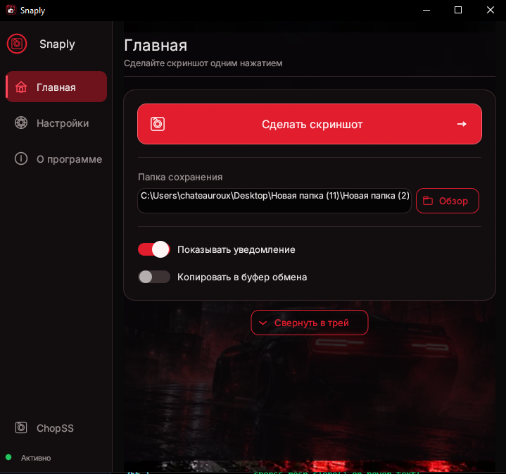
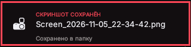
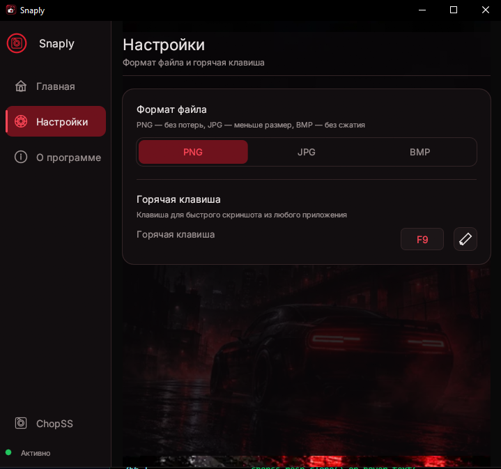
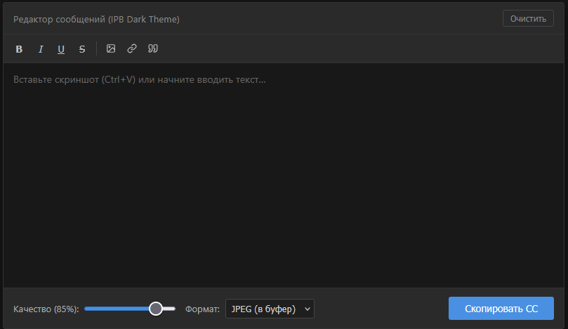

# Snaply


**Лёгкая утилита для скриншотов под Windows** с тёмным геймерским UI, глобальным хоткеем, кастомными тост-уведомлениями в стиле Steam и встроенной утилитой нарезки скриншот-ситуаций ChopSS.

Написано, как несложно понять, на крабе. Почему краб? Потому что он более "ошибкоустойчивый", нежели С++, и можно это все собрать в один нормальный бинарник, который будет работать везде, а не как у питона, где к exe нужно еще тянуть сам Питон.

---

## ✨ Возможности

### Основной функционал

- **Скриншот по горячей клавише** — нажми `F9` (по умолчанию) в любом приложении, даже в полноэкранной игре, и скриншот сохранится автоматически.
- **Глобальный хоткей** — регистрация через Win32 `RegisterHotKey`, работает из Borderless/Windowed Fullscreen.
- **Переназначение хоткея** — нажми карандаш в настройках и любую клавишу.
- **Выбор формата** — PNG (без потерь, быстрое сжатие), JPG (сжатый, конвертация RGBA→RGB), BMP (без сжатия).
- **Выбор папки сохранения** — через диалог или ручной ввод пути.
- **Имя файла** — `Screen_YYYY-MM-DD_HH-MM-SS.ext`.
- **Авто-копирование в буфер обмена** — опционально, после каждого скриншота.

### Уведомления

- **Кастомный тост-оверлей** в стиле Steam — отдельное окно без рамок, AlwaysOnTop, с плавным fade-in/fade-out.
- **Имя файла в тосте** — видно, что именно сохранилось.
- **Звук уведомления** — `assets/notification.wav` (свой звук из FL Studio/любого редактора) или системный `MessageBeep` как фолбэк.
- **Опционально** — можно отключить в настройках.

### Системный трей

- **Сворачивание в трей** — при закрытии окна крестиком или кнопкой «Свернуть в трей».
- **Меню трея** — «Показать окно» / «Выход».
- **Клик по иконке** — восстановление окна.
- **Single-instance** — защита от дублирования процессов через named mutex.

### Производительность

- **0% CPU в простое** — reactive repaint (4 FPS в покое, 30 FPS для тоста).
- **Быстрый PNG** — `CompressionType::Fast` + `FilterType::Sub` (5x быстрее дефолта).
- **Изоляция потоков** — захват экрана и кодирование PNG в фоновом потоке, UI не фризит.
- **Тост сразу** — показывается до завершения захвата, без задержки.

### ChopSS — встроенная утилита нарезки скриншотов

Отдельная утилита для сборки скриншот-ситуаций методом нарезки. Открывается в системном браузере (Chrome/Edge/Firefox) по клику на пункт «ChopSS» в боковой навигации.

**Возможности ChopSS:**
- Вставка скриншотов через `Ctrl+V` или drag&drop
- Текстовое поле с форматированием (B/I/U/S, изображение, ссылка, цитата)
- Регулировка качества JPEG (10–100%)
- Экспорт в буфер обмена (JPEG в PNG-контейнере) или в файл PNG
- Полностью оффлайн — `html2canvas` локально

---

## 🚀 Установка

### Сборка из исходников

```powershell
git clone https://github.com/chateauroux/snaply.git
cd snaply
cargo build --release
```

Готовый `.exe` будет в `target/release/snaply.exe`.

### Требования

- **Windows 10/11** (64-bit)
- **Любой современный браузер** — для ChopSS (Chrome, Edge, Firefox и т.д.)
- **Rust 1.75+** — для сборки из исходников

---

## 📁 Структура проекта

```
snaply/
├── Cargo.toml
├── LICENSE                          # MIT
├── README.md
├── .gitignore
├── docs/
│   └── screenshots/                 # Галерея интерфейса для README
│       ├── main.png                 # Главное окно
│       ├── notify.png               # Тост-уведомление
│       ├── settings.png             # Панель настроек
│       └── chopSS.png               # ChopSS (компилятор скриншот-ситуаций)
├── assets/
│   ├── snaply.ico                   # Иконка приложения
│   ├── notification.wav             # Звук тоста (опционально)
│   ├── background.png               # Фон главного окна (опционально)
│   ├── fonts/
│   │   ├── Inter.ttf                # Шрифт Inter (OFL 1.1)
│   │   └── LICENSE.txt
│   └── chopss/
│       ├── index.html               # Утилита нарезки скриншотов
│       └── html2canvas.min.js
└── src/
    ├── main.rs                      # Точка входа, UI, навигация
    ├── material.rs                  # Тёмная тема + виджеты
    ├── icons.rs                     # Векторные иконки через Painter
    ├── capture.rs                   # Захват экрана через GDI BitBlt
    ├── hotkey.rs                    # Глобальный хоткей (RegisterHotKey)
    ├── notification.rs              # Кастомный тост-оверлей
    ├── sound.rs                     # Звук уведомления
    ├── tray.rs                      # Системный трей
    ├── single_instance.rs           # Защита от дублей процесса
    ├── config.rs                    # Настройки (сохранение/загрузка)
    └── chopss.rs                    # Открытие ChopSS в браузере
```

---

## ⚙️ Настройка

### Папка сохранения

По умолчанию: `Pictures/FiveM_Screens` в профиле пользователя. Можно изменить в главном окне или через диалог «Обзор».

### Горячая клавиша

По умолчанию: `F9`. Переназначается на странице «Настройки» — нажми карандаш и любую клавишу.

### Формат файла

- **PNG** — без потерь, быстрое сжатие. Рекомендуется для большинства случаев.
- **JPG** — сжатый, конвертация RGBA→RGB. Меньше размер, потери качества.
- **BMP** — без сжатия. Большой размер, максимальное качество.

### Звук уведомления

Положи `notification.wav` в `assets/` рядом с `.exe`. Формат: WAV 16-bit 44.1kHz, длительность 0.3–1.0 сек. Если файла нет — используется системный `MessageBeep`.

### Фон главного окна

Положи `background.png` в `assets/`. Любой размер, растягивается с сохранением пропорций (cover-fit) + тёмный оверлей 85%. Если файла нет — тёмный градиент.

### Иконка приложения

Положи `snaply.ico` в `assets/`. Используется в трее, заголовке окна и taskbar. Если файла нет — генерируется бордовый круг.

---

## 🎨 Скриншоты

### Главное окно



Тёмная тема с бордовыми акцентами, боковая навигация (Главная / Настройки / О программе / ChopSS), карточка с кнопкой скриншота, папкой сохранения и переключателями.

### Тост-уведомление



Прямоугольник без скругления с жирной красной обводкой 3px, иконка камеры, заголовок «СКРИНШОТ СОХРАНЁН» и имя файла.

### Настройки



Панель конфигурации: формат файла (PNG/JPG/BMP), горячая клавиша с переназначением.

### ChopSS — компилятор скриншот-ситуаций



Режим склейки скриншот-ситуаций — открывается в системном браузере. Вставка через `Ctrl+V`, регулировка качества JPEG, экспорт в буфер или файл.

---

## 🛠 Технологии

| Компонент | Технология |
|---|---|
| GUI | `eframe` + `egui` 0.29 |
| Захват экрана | Win32 GDI (`BitBlt` + `GetDIBits`) |
| Глобальный хоткей | Win32 `RegisterHotKey` + `GetMessageW` |
| Системный трей | `tray-icon` 0.19 |
| Буфер обмена | `arboard` 3 |
| Диалог папок | `rfd` 0.15 |
| Сохранение изображений | `image` 0.25 (быстрое PNG-сжатие) |
| ChopSS | HTML + `html2canvas` (локально), открывается в системном браузере |
| Шрифт | Inter (OFL 1.1) |
| Single-instance | Win32 `CreateMutexW` |

---

## 📝 Лицензия

**MIT** — см. [LICENSE](LICENSE).

Шрифт **Inter** распространяется под [SIL Open Font License 1.1](assets/fonts/LICENSE.txt).

Библиотека **html2canvas** (в `assets/chopss/`) распространяется под MIT.

---

## 👤 Автор

**chateauroux**
- GitHub: [https://github.com/chateauroux](https://github.com/chateauroux)
- Репозиторий: [https://github.com/chateauroux/snaply](https://github.com/chateauroux/snaply)

---

## 🤝 Содействие

Нашли баг или есть идея? Создайте [Issue](https://github.com/chateauroux/snaply/issues) или отправьте Pull Request.

---

## ⚠️ Известные ограничения

- **Эксклюзивный Fullscreen** (DirectX/Vulkan exclusive mode) — GDI `BitBlt` может дать чёрный кадр. Используйте Borderless или Windowed Fullscreen.
- **ChopSS** — открывается в системном браузере как отдельная вкладка/окно. Для оффлайн-работы `html2canvas.min.js` лежит локально в `assets/chopss/`.
- **Многомониторные setup'ы** — тост всегда в правом нижнем углу основного монитора.
